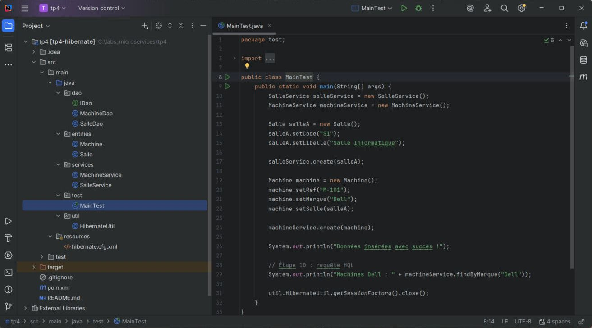
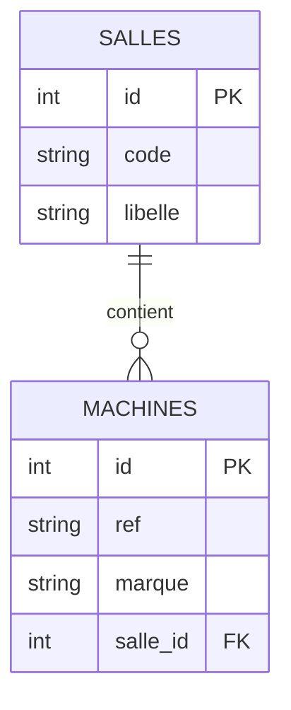
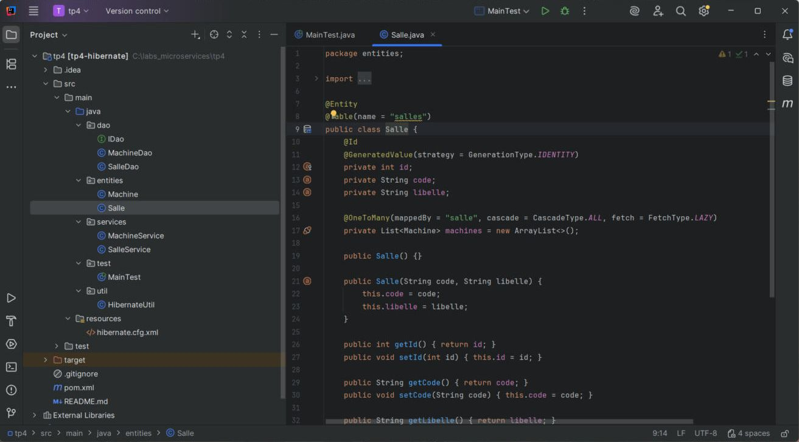
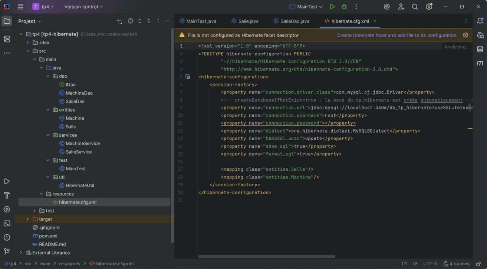
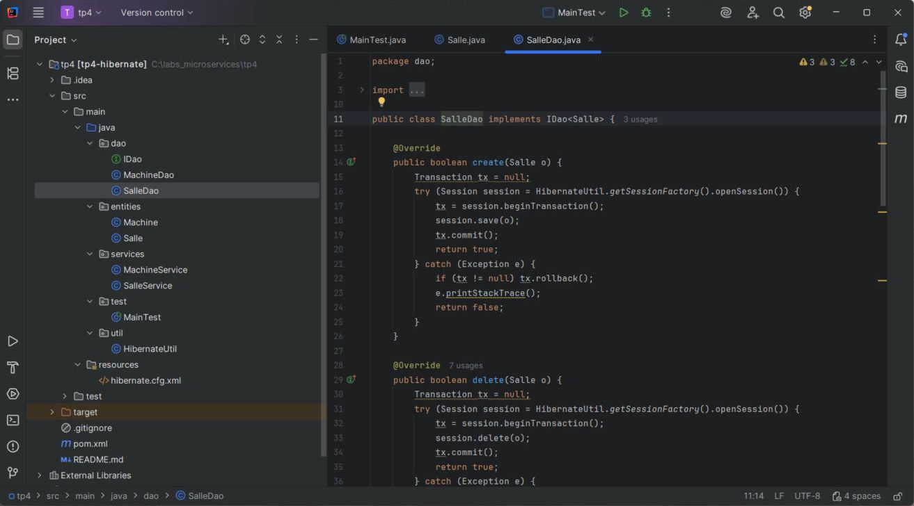
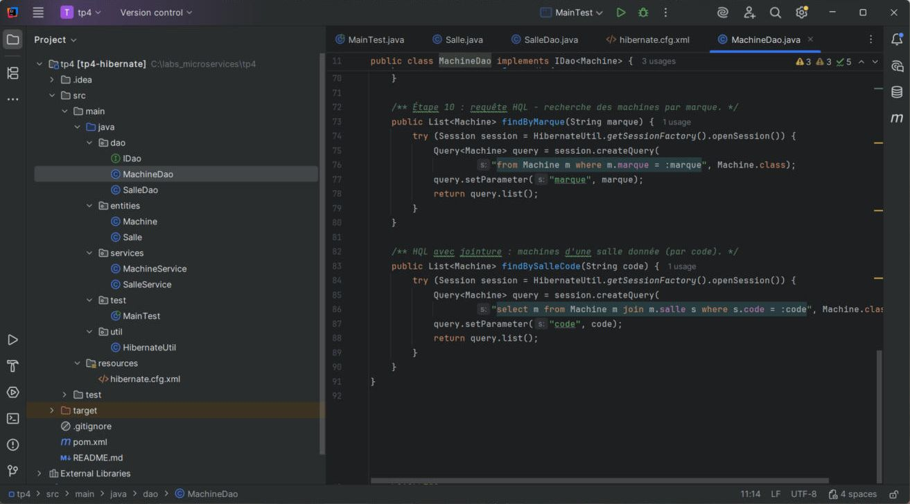

# TP 4 – Hibernate et Persistance des Données

> Module : **Architecture Microservices – Conception, Déploiement et Orchestration**

Ce TP met en place une application Java qui enregistre ses données dans **MySQL** grâce à l'ORM **Hibernate**.
Le code est organisé en couches (**Entités → DAO → Services**) et validé par des tests **JUnit 5**.



---

## Sommaire

1. [Objectifs](#objectifs)
2. [Technologies](#technologies)
3. [Architecture du projet](#architecture-du-projet)
4. [Modèle de données](#modèle-de-données)
5. [Réalisation pas à pas](#réalisation-pas-à-pas)
6. [Lancer le projet](#lancer-le-projet)
7. [Résumé du TP](#résumé-du-tp)

---

## Objectifs

- Comprendre le fonctionnement d'un **ORM** (Object-Relational Mapping) : manipuler des objets Java au lieu d'écrire du SQL.
- Configurer Hibernate avec **Maven** et un fichier **XML**.
- Mettre en place une **architecture en couches** (Entités, DAO, Services).
- Valider les opérations **CRUD** avec **JUnit**.

## Technologies

| Outil | Version | Rôle |
|-------|---------|------|
| Java | 17 | Langage |
| Maven | 3.x | Gestion des dépendances et du build |
| Hibernate Core | 5.6.15.Final | ORM (implémentation de JPA) |
| MySQL Connector/J | 8.0.33 | Pilote JDBC MySQL |
| JUnit Jupiter | 5.9.2 | Tests unitaires |
| IntelliJ IDEA | 2025.2 | IDE |

## Architecture du projet

```
tp4/
├── pom.xml
├── screenshots/                     # captures d'écran du README
└── src
    ├── main
    │   ├── java
    │   │   ├── dao
    │   │   │   ├── IDao.java          # interface DAO générique (CRUD)
    │   │   │   ├── SalleDao.java      # implémentation Hibernate pour Salle
    │   │   │   └── MachineDao.java    # implémentation + requêtes HQL
    │   │   ├── entities
    │   │   │   ├── Salle.java         # @OneToMany  -> Machine
    │   │   │   └── Machine.java       # @ManyToOne  -> Salle
    │   │   ├── services
    │   │   │   ├── SalleService.java
    │   │   │   └── MachineService.java
    │   │   ├── test
    │   │   │   └── MainTest.java      # insertion des premières données
    │   │   └── util
    │   │       └── HibernateUtil.java # SessionFactory unique
    │   └── resources
    │       └── hibernate.cfg.xml      # configuration Hibernate / MySQL
    └── test/java/services
        ├── SalleServiceTest.java      # tests JUnit CRUD Salle
        └── MachineServiceTest.java    # tests JUnit CRUD, HQL, rollback
```

Le flux d'un appel suit toujours le même chemin :

```
MainTest / Tests JUnit  →  Service  →  DAO  →  Hibernate (Session)  →  MySQL
```

- **Entités** : classes Java annotées qui représentent les tables.
- **DAO** (Data Access Object) : seul endroit qui parle à Hibernate (ouvre la session, gère la transaction).
- **Service** : couche métier, appelle le DAO ; c'est elle que le reste de l'application utilise.

## Modèle de données

Une **Salle** contient plusieurs **Machines** ; chaque machine appartient à une seule salle.



Hibernate crée ces deux tables automatiquement (`hbm2ddl.auto = update`).

---

## Réalisation pas à pas

### Étape 1 – Dépendances Maven (`pom.xml`)

On ajoute **hibernate-core**, **mysql-connector-java** et **junit-jupiter**. Après un rechargement Maven, IntelliJ télécharge toutes les bibliothèques.

### Étape 2 – Interface DAO générique

`IDao<T>` définit le contrat CRUD commun à toutes les entités. Ainsi, la logique métier ne dépend pas de la technique de persistance.

```java
public interface IDao<T> {
    boolean create(T o);
    boolean delete(T o);
    boolean update(T o);
    T getById(int id);
    List<T> getAll();
}
```

### Étape 3 – Entités JPA `Salle` et `Machine`

- `@Entity` / `@Table` : la classe correspond à une table.
- `@Id` + `@GeneratedValue(IDENTITY)` : clé primaire auto-incrémentée par MySQL.
- `@OneToMany(mappedBy = "salle")` dans `Salle` et `@ManyToOne @JoinColumn(name = "salle_id")` dans `Machine` : relation 1-N, la clé étrangère est dans la table `machines`.
- `cascade = ALL` : supprimer une salle supprime aussi ses machines. `fetch = LAZY` : les machines ne sont chargées que si on les demande.



### Étape 4 – Configuration Hibernate (`hibernate.cfg.xml`)

Ce fichier contient la connexion MySQL (URL, utilisateur, mot de passe), le dialecte `MySQL8Dialect`, la génération automatique du schéma (`update`), l'affichage des requêtes SQL (`show_sql`, `format_sql`) et la liste des classes mappées.

> `createDatabaseIfNotExist=true` a été ajouté dans l'URL pour que la base `db_tp_hibernate` soit créée automatiquement.



### Étape 5 – Classe utilitaire `HibernateUtil`

Elle construit **une seule** `SessionFactory` (objet coûteux) au démarrage, puis la partage dans toute l'application (pattern Singleton).

### Étape 6 – DAO spécifiques

`SalleDao` et `MachineDao` implémentent `IDao<T>`. Chaque écriture suit le même schéma :

1. ouvrir une `Session` (try-with-resources, fermée automatiquement) ;
2. démarrer une `Transaction` ;
3. `save` / `update` / `delete` ;
4. `commit`, ou `rollback` en cas d'exception.



### Étape 7 – Couche Service

`SalleService` et `MachineService` délèguent au DAO. C'est l'endroit où l'on ajouterait les règles métier (validation, calculs…).

### Étape 8 – Classe `MainTest`

Elle crée la salle **S1 – Salle Informatique** et la machine **M-101 (Dell)** rattachée à cette salle. Au premier lancement, Hibernate crée les tables `salles` et `machines`, puis insère les lignes.

### Étape 9 – Tests unitaires JUnit 5

| Test | Ce qui est vérifié |
|------|--------------------|
| `SalleServiceTest.testCreateSalle` | l'insertion d'une salle réussit |
| `SalleServiceTest.testCrudSalle` | create → getById → update → getAll → delete |
| `MachineServiceTest.testCrudMachine` | CRUD complet d'une machine liée à une salle |
| `MachineServiceTest.testFindByMarqueHQL` | les requêtes HQL renvoient les bonnes machines |
| `MachineServiceTest.testTransactionRollback` | une erreur déclenche bien un rollback + exception |

### Étape 10 – Requêtes HQL

Le **HQL** (Hibernate Query Language) interroge les **classes et attributs Java**, pas les tables. Il ne dépend donc pas du SGBD.

- `findByMarque` : `from Machine m where m.marque = :marque`
- `findBySalleCode` (jointure) : `select m from Machine m join m.salle s where s.code = :code`

Les paramètres nommés (`:marque`) protègent contre l'injection SQL.



### Étape 11 – Transactions et gestion des erreurs

La méthode `createSalleAvecMachines` enregistre une salle **et** ses machines dans **une seule transaction**. Si une opération échoue, tout est annulé (`rollback`), puis une `RuntimeException("Erreur transactionnelle : …")` est levée : la base ne reste jamais dans un état à moitié écrit.

---

## Lancer le projet

1. Démarrer un serveur **MySQL** sur `localhost:3306` (XAMPP, WAMP, service MySQL ou Docker).
2. Adapter `connection.username` et `connection.password` dans `src/main/resources/hibernate.cfg.xml`.
3. Ouvrir le dossier dans IntelliJ IDEA (projet Maven), puis exécuter **`test.MainTest`**.
   Résultat attendu dans la console : les requêtes SQL générées, puis `Données insérées avec succès !`
4. Lancer les tests :

```bash
mvn test
```

ou, dans IntelliJ, faire un clic droit sur `src/test/java`, puis **Run 'All Tests'**.

---

## Résumé du TP

Ce TP a permis de construire une couche de persistance complète avec Hibernate :

- **Configuration** : Hibernate est branché sur MySQL via Maven et `hibernate.cfg.xml`. Une seule `SessionFactory` est gérée par `HibernateUtil`.
- **Mapping objet-relationnel** : les classes `Salle` et `Machine` deviennent des tables. La relation **One-to-Many / Many-to-One** est traduite en clé étrangère `salle_id`.
- **Architecture en couches** : l'interface générique `IDao<T>`, ses implémentations Hibernate et la couche Service séparent clairement l'accès aux données et la logique métier.
- **Requêtes HQL** : recherche typée et indépendante du SGBD, avec paramètres nommés et jointures.
- **Transactions** : chaque écriture est atomique (`commit` / `rollback`). Les écritures multiples sont protégées contre les données partielles.
- **Tests** : JUnit 5 vérifie automatiquement tout le cycle CRUD, les requêtes HQL et le rollback.

**Pistes d'amélioration** : comparer les chargements LAZY et EAGER, ajouter un pool de connexions (HikariCP), puis passer à Spring Data JPA dans une architecture microservices.
